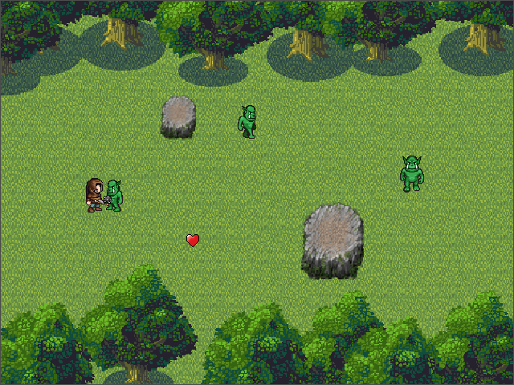
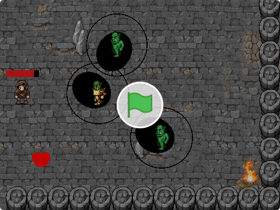
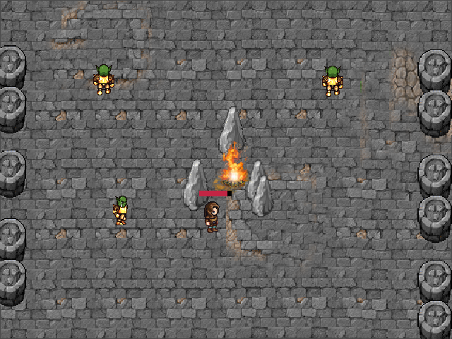
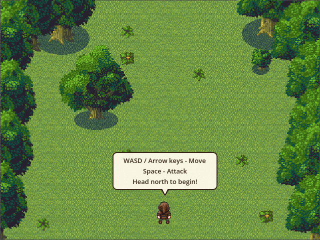
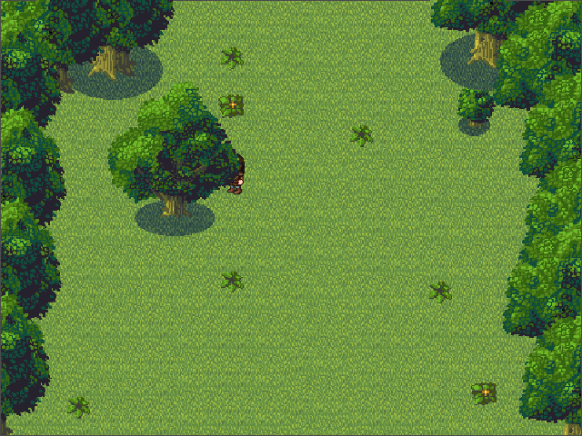
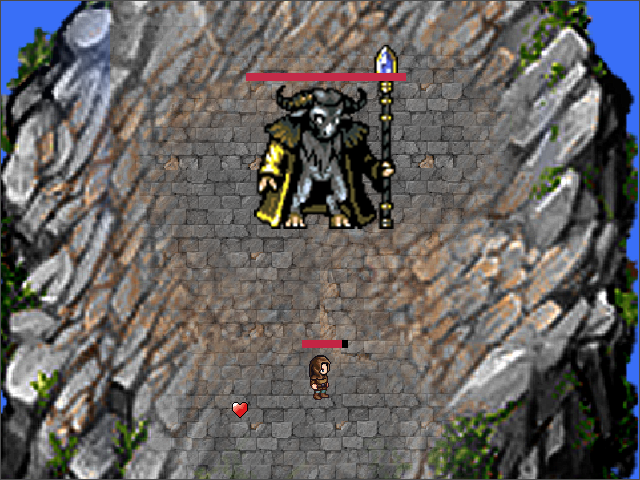

# Scratch RPG

A small top-down action RPG made with **Godot 4**, rebuilt from a game I first made in **Scratch** for my CS50 class in 2020.

Fight your way from a quiet forest, through a dungeon, up to a boss on a cliff top.

  

## From Scratch to Godot

The original game is still on Scratch: **[simple rpg game for project](https://scratch.mit.edu/projects/382855980/)**.
I was just starting out when I made it. Years later I rebuilt it from scratch (pun intended) in Godot, using the same art, to see how far I could take it.

| Scratch (2020) | Godot (now) |
|---|---|
|  |  |

## Screenshots

| | |
|---|---|
|  |  |
| **The start:** a controls hint, then head north | **Depth:** walk behind trees, rocks and pillars |
|  |  |
| **The dungeon:** grunts guard the campfire | **The boss:** dodge the fireballs |

## How to play

| Action | Keyboard | Gamepad |
|---|---|---|
| Move | `WASD` or arrow keys | Left stick |
| Attack | `Space` | Bottom face button |

Walk off the edge of an area to move to the next one. Hearts heal you to full health. Defeat the boss to win.

## Features

- 11 connected areas: forest, ruins, dungeon and a boss arena
- Grunts that wander, chase and attack when you get close
- A boss fight with fireballs
- Combat feedback: hit flash, screen shake and a short hit-stop on every hit
- Health bars and heart pickups
- Depth sorting, so you can walk behind trees, rocks and pillars. The levels are single baked images, so this is done by redrawing parts of each image on top of the player.

## Running it yourself

1. Install [Godot 4.7](https://godotengine.org/download). The standard build is enough; the game is pure GDScript.
2. Clone this repo and open `project.godot` in Godot.
3. Press **F5** to play.

### Exporting for the web

The project has a **Web** export preset with thread support turned off, so the build runs on itch.io and GitHub Pages without special server headers.

1. Use the **standard** Godot editor. The .NET (C#) editor can't export to the web.
2. Install the export templates: **Editor → Manage Export Templates → Download and Install**.
3. Open **Project → Export**, select **Web** and click **Export Project**. The build goes to `build/web/`.
4. To test it locally, click the browser icon (**Remote Debug → Run in Browser**) in the top-right of the editor.
5. To publish on itch.io, zip the *contents* of `build/web/`, upload the zip and tick **"This file will be played in the browser"**.

## Credits

All art is free art from [OpenGameArt.org](https://opengameart.org). I collected it back in 2020 for the Scratch version. I no longer have a record of which piece came from which artist, so here are the credits I have:

- Art by **MrBeast**, commissioned by OpenGameArt.org
- Artwork created by **Luis Zuno** (@ansimuz)
- Original sprites by **Stephen Challener (Redshrike)**

If you made any of these assets and want the credit changed, please open an issue.
